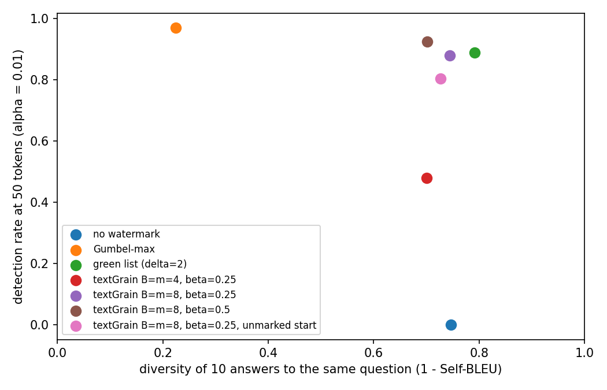

# textGrain: reimplementation and evaluation

A reimplementation of textGrain, the text watermark described in OpenAI's technical report of 5 October 2026 ([pdf](https://cdn.openai.com/pdf/e9508624-d767-41b6-a26d-e34ca798ada6/textgrain-entropy-calibrated-watermarking-for-language-model-text.pdf)), on Qwen2.5-1.5B-Instruct, with an evaluation the report does not include: detection power, diversity, text quality, false positives and robustness, compared with Gumbel-max and green-list watermarks.

## How textGrain works

At each step, a secret key and the last few tokens seed a random generator that splits the vocabulary into B blocks and draws a B × m table of Gumbel variables and a column J.
A coupling between blocks and m columns is computed by Sinkhorn iterations: it favours (block, column) cells with large Gumbel values, keeps the next-token distribution unchanged on average over columns, and removes a chosen fraction β of its entropy.
The next block is sampled from column J, then the token inside the block with the model's own probabilities.
The detector only needs the text and the key: it rebuilds the table at each position, reads the uniform U of the cell (block of the written token, J) and sums −ln(1 − U), which follows a Gamma law on human text.

## Results



200 continuations of C4 news articles (400 tokens), detection at α = 0.01; diversity over 10 answers to each of 30 open questions; perplexity under Qwen2.5-3B; paraphrase by Phi-3.5-mini.

| | detected at 25 / 50 / 100 tokens | Self-BLEU (lower is more diverse) | median perplexity | detected after paraphrase |
|---|---|---|---|---|
| no watermark | - | 0.25 | 20.3 | - |
| Gumbel-max | 0.92 / 0.97 / 0.99 | 0.78 | 18.2 | 0.72 |
| green list (δ = 2) | 0.66 / 0.89 / 0.97 | 0.21 | 45.1 | 0.24 |
| textGrain B = m = 4, β = 0.25 | 0.17 / 0.48 / 0.80 | 0.30 | 19.3 | 0.12 |
| textGrain B = m = 8, β = 0.25 | 0.67 / 0.88 / 0.97 | 0.26 | 22.1 | 0.29 |

Main observations, detailed in [REPORT.md](REPORT.md):

- The number of blocks and columns matters more than β. At the same entropy cost, B = m = 8 detects 67 % of texts after 25 tokens, B = m = 4 only 17 %.
- textGrain's signal per token saturates on high-entropy positions, because a coupling with m columns cannot remove more than ln m nats. Asking for a larger β beyond this ceiling changes nothing.
- With B = m = 8, textGrain matches the green list in detection while keeping the diversity of the unwatermarked model and without doubling perplexity. Gumbel-max detects best but gives near-identical answers to a repeated prompt.
- With a fixed key, frequent contexts always receive the same random draw. The empty context at the start of every answer biases the first words of all texts, and frequent contexts make the null p-values slightly non-uniform. Both are fixed by leaving the first positions unwatermarked and ignoring frequent contexts at detection.

## Repository

```
src/textgrain/    model loading, generation loop, keys, Gumbel-max, green list, textGrain coupling, detectors
tests/            unit tests, including the toy example of the brief (HMAC, blocks, lambda, coupling)
experiments/      generation, scoring, perplexity, attacks, analysis, and the Kaggle notebooks used for the runs
figures/          figures of the report and text examples
```

## Reproducing

```
uv sync
uv run pytest
uv run python experiments/generate.py --model Qwen/Qwen2.5-1.5B-Instruct --method textgrain --beta 0.25 --blocks 8 --columns 8 --n-prompts 200 --no-eos --out results/textgrain_B8_b0.25.jsonl
uv run python experiments/score.py results/*.jsonl
uv run python experiments/analyze.py
```

The full runs (about 6 GPU hours on two T4) are in `experiments/kaggle_run*.ipynb`.
