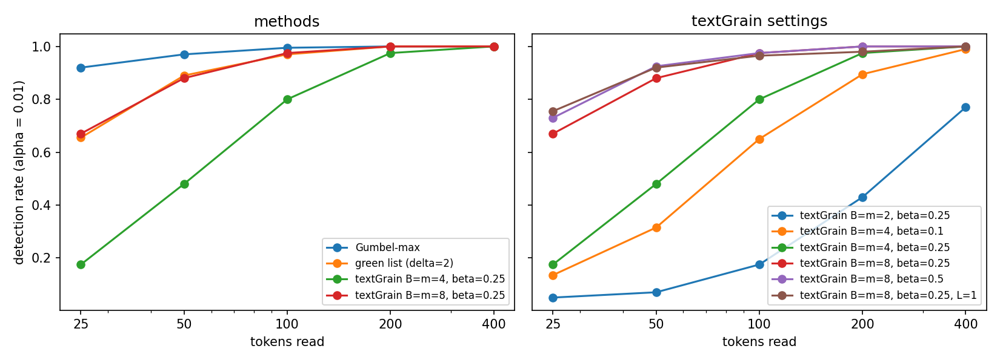
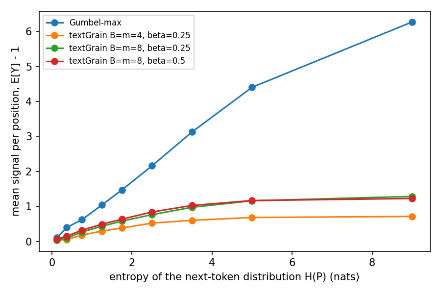

# textGrain: an empirical evaluation

The textGrain report specifies the method and proves that it preserves the next-token distribution on average over keys, but it gives no experiment. This note measures what the method does on a small open model, and how its parameters, which the report leaves free, change the result.

## 1. Setup

- Model: Qwen2.5-1.5B-Instruct, temperature 1, no top-p truncation.
- Prompts: the first 100 tokens of 200 C4 news articles (realnewslike, validation), with the instruction to continue the article. The real continuation serves as the human reference. Generations have 400 tokens; the end-of-text token is forbidden so that every text reaches 400 tokens (see section 2 for the effect of this choice).
- Watermarks: Gumbel-max; green list with γ = 0.25 and δ = 2; textGrain with B = m ∈ {2, 4, 8} and β ∈ {0.1, 0.25, 0.5, 0.75}. All three use the same key, the same context window (the last L = 2 tokens unless stated), and sample freely at contexts already seen in the text.
- Detection: one score per position, at the first occurrence of each context; Gamma test for Gumbel-max and textGrain, binomial test for the green list; α = 0.01.
- Diversity: 30 open questions (4 written by hand, 26 from Dolly), 10 answers each with the same key, 150 tokens. Self-BLEU is the mean BLEU-4 of each answer against the 9 others.
- Quality: perplexity of the continuation under Qwen2.5-3B-Instruct, given the article prefix.
- Attacks: on 100 texts per method, WordNet synonyms for 10, 20 and 30 % of the words, round-trip translation English, French, English (MarianMT), and paraphrase by Phi-3.5-mini-instruct.

## 2. Detection power

| | 25 | 50 | 100 | 200 | 400 tokens | entropy removed |
|---|---|---|---|---|---|---|
| Gumbel-max | 0.92 | 0.97 | 0.99 | 1.00 | 1.00 | all |
| green list | 0.66 | 0.89 | 0.97 | 1.00 | 1.00 | - |
| textGrain B = m = 2, β = 0.25 | 0.05 | 0.07 | 0.17 | 0.43 | 0.77 | 0.10 |
| textGrain B = m = 4, β = 0.1 | 0.14 | 0.32 | 0.65 | 0.90 | 0.99 | 0.10 |
| textGrain B = m = 4, β = 0.25 | 0.17 | 0.48 | 0.80 | 0.97 | 1.00 | 0.21 |
| textGrain B = m = 4, β = 0.5 | 0.17 | 0.45 | 0.81 | 0.97 | 1.00 | 0.24 |
| textGrain B = m = 8, β = 0.25 | 0.67 | 0.88 | 0.97 | 1.00 | 1.00 | 0.25 |
| textGrain B = m = 8, β = 0.5 | 0.73 | 0.93 | 0.97 | 1.00 | 1.00 | 0.35 |
| textGrain B = m = 8, β = 0.75 | 0.74 | 0.93 | 0.98 | 1.00 | 1.00 | 0.36 |

The removed fraction is the one actually achieved, averaged over the text. It stays below the request when the request exceeds what the coupling allows: about 0.24 for B = m = 4 and 0.36 for B = m = 8 on these texts.

At equal cost, B and m change the detection rate far more than β: with a quarter of the entropy removed, 17 % of texts are detected after 25 tokens with 4 blocks and 67 % with 8.

Forcing 400 tokens could favour detection if the text continued past the point where the model wanted to stop. On these prompts, 192 of the 200 texts had not reached that point by token 200, and restricting each length to the texts still before it leaves the rates unchanged to within 0.01.

## 3. Where the signal comes from

The mean score per position, minus its value of 1 on human text, grows roughly linearly with the entropy of the position for Gumbel-max. For textGrain it saturates above about 3 nats, near 0.7 for m = 4 and 1.2 for m = 8. The coupling between blocks and m columns can remove at most ln m nats (1.4 for m = 4, 2.1 for m = 8), so high-entropy positions, which carry most of the signal for Gumbel-max, are capped. This explains both the effect of B and m and the ceiling on β.

Signal per position divided by the entropy removed per position:

| | B = m = 2, β = 0.25 | B = m = 4, β = 0.1 | B = m = 4, β = 0.25 | B = m = 8, β = 0.25 | B = m = 8, β = 0.5 |
|---|---|---|---|---|---|
| signal per nat | 0.67 | 1.40 | 0.81 | 1.10 | 0.81 |

The first nats removed are the most useful; returns then decrease, more slowly with more columns.

The context window has a smaller effect. With B = m = 8 and β = 0.25, L = 1 detects 76 % of texts after 25 tokens, L = 2 67 % and L = 4 66 %. A shorter window repeats contexts more often but also lets each position be scored earlier.

## 4. Diversity and quality

| | distinct answers out of 10 | Self-BLEU | median perplexity | Mann-Whitney p against no watermark |
|---|---|---|---|---|
| no watermark | 9.9 | 0.25 | 20.3 | - |
| Gumbel-max | 7.0 | 0.78 | 18.2 | 0.86 |
| green list | 10.0 | 0.21 | 45.1 | < 0.001 |
| textGrain B = m = 4, β = 0.25 | 9.8 | 0.30 | 19.3 | 0.44 |
| textGrain B = m = 8, β = 0.25 | 10.0 | 0.26 | 22.1 | 0.13 |
| textGrain B = m = 8, β = 0.5 | 10.0 | 0.30 | 23.3 | 0.02 |

Gumbel-max answers to the same question are near copies: they only differ after a repeated context, where sampling is free. textGrain keeps the diversity of the unwatermarked model. The green list more than doubles perplexity; the answers in [figures/examples.md](figures/examples.md) show why, with phrases such as "watermark sinusoidal recovery devices" that the other methods do not produce.

textGrain's perplexity rises slightly with B and β, and the rise is significant for β ≥ 0.5. Its sampler is unbiased position by position (6,000 draws on a fixed distribution with fresh contexts match it, χ² per degree of freedom 0.68), and leaving the first positions unwatermarked (section 5) does not remove the rise. The cause is still open.

## 5. False positives with a fixed key

The report notes that a fixed key needs empirical calibration. Two effects appear here.

Start of the answer. The first token has an empty context, so it receives the same partition, table and column in every text. The watermark then pushes all texts towards the same openings: with B = m = 8, 8 of 200 continuations start with "Despite", against none without watermark. Leaving the first L positions unwatermarked and unscored restores exactly the unwatermarked openings, for a small loss in detection (55 % instead of 67 % after 25 tokens, identical from 200 tokens).

Frequent contexts. Pairs such as "of the" occur in many texts and always meet the same draw, so the scores of different human texts are not independent. On 1,000 human continuations, the rate below α = 0.01 stays between 0.4 % and 1.6 %, but the p-values are not uniform for textGrain with few blocks:

| detector | below 0.01 | KS p-value, all positions | KS p-value, contexts in more than 1 % of texts removed |
|---|---|---|---|
| Gumbel-max | 0.015 | 0.42 | 0.58 |
| textGrain B = 2 | 0.007 | < 0.001 | 0.27 |
| textGrain B = 4 | 0.011 | 0.004 | 0.58 |
| textGrain B = 8 | 0.016 | 0.29 | 0.05 |

(The binomial p-values of the green list are discrete, so the KS test does not apply to them.)

## 6. Robustness

Detection rate at α = 0.01 after each modification, on 100 texts of 400 tokens:

| | synonyms 10 % | 20 % | 30 % | round-trip translation | paraphrase |
|---|---|---|---|---|---|
| Gumbel-max | 1.00 | 1.00 | 1.00 | 1.00 | 0.72 |
| green list | 1.00 | 1.00 | 1.00 | 0.99 | 0.24 |
| textGrain B = m = 4 | 0.99 | 0.98 | 0.88 | 0.74 | 0.12 |
| textGrain B = m = 8 | 1.00 | 1.00 | 0.99 | 0.96 | 0.29 |

Word substitutions do not remove the watermark at this length. Paraphrase removes most of it for all methods except Gumbel-max, whose stronger signal per token survives in the fragments the paraphrase keeps. More blocks and columns make textGrain markedly more robust.

## 7. Limitations

One model of 1.5B parameters, one key, 200 texts per setting and 100 per attack; Self-BLEU only measures surface overlap; the paraphraser is a single small model. The perplexity rise of section 4 is not explained.
